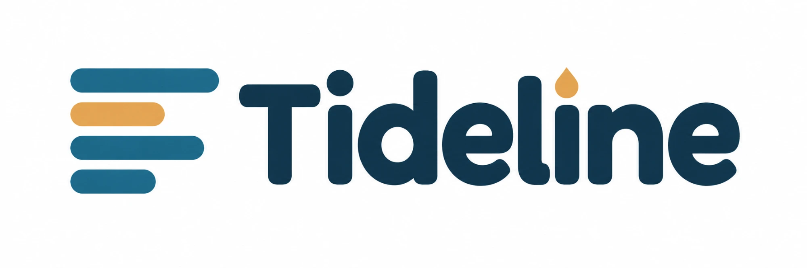
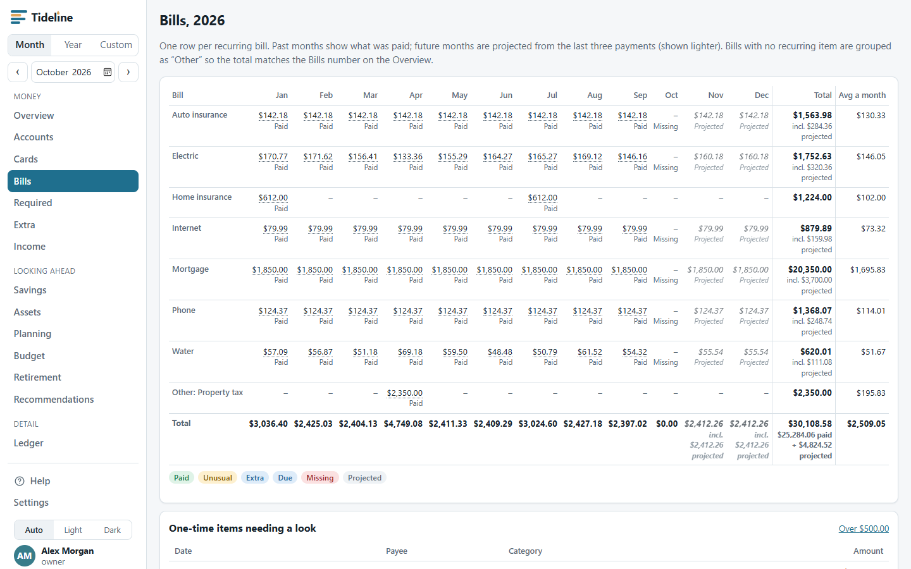
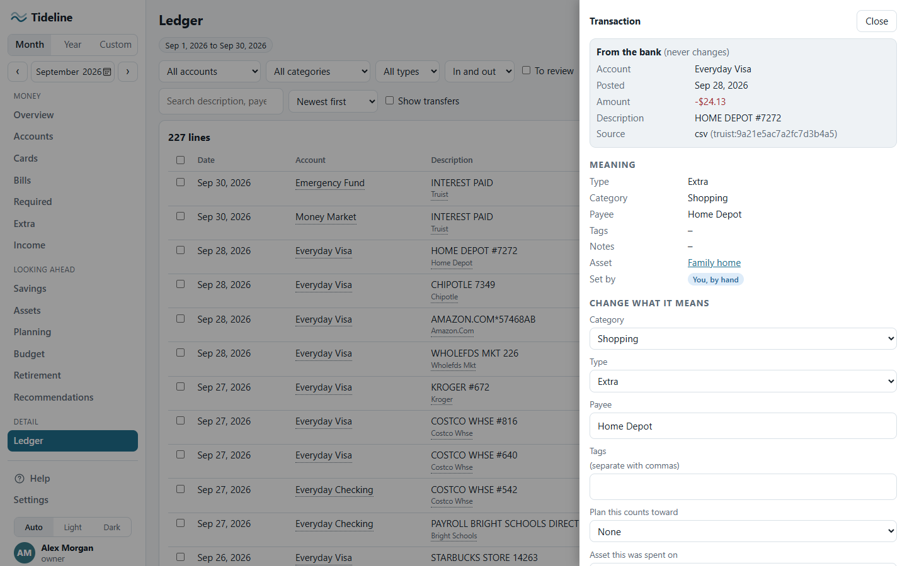
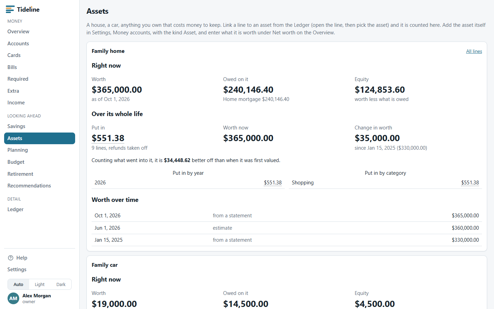
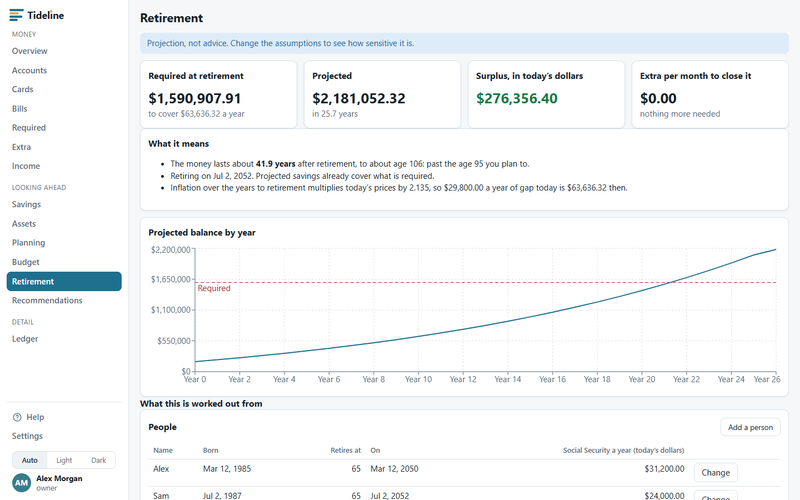
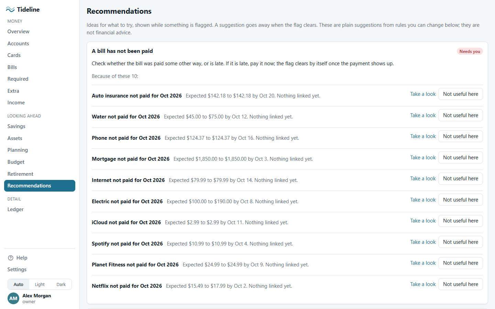
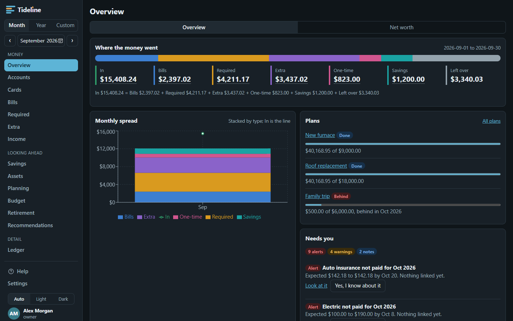

<h1 align="center">
  
</h1>

<p align="center"><strong>A private household money ledger</strong></p>

> Know where the money went, and what needs you, without it becoming a hobby.

Tideline is a self-hosted ledger for a household. You give it your bank exports, it sorts every transaction, and it shows where the month's money went: what came in, what the bills were, what you had to spend, what you chose to spend, what you saved, and what was left. It keeps quiet until something needs a person, such as a bill that did not get paid or a card balance that was carried over. One Docker image, one data folder, nothing sent anywhere.

---

## A Note on How This Is Built

Tideline is built with **[Claude Code](https://claude.ai/code)**. The behaviour is written down first, in [`docs/`](docs/README.md), and that spec is the contract: code that disagrees with it is a bug. Work is broken into phases tracked as GitHub issues, and every change ships with tests (xUnit for the server, Vitest and Playwright for the web app, and a CI run on Linux). The issue history and the commit log show how each piece got here.

---

## What it does

Tideline is three things in one app:

- **A ledger you can trust.** Every bank line is kept exactly as the bank gave it and can never be edited or deleted. You change what a line *means* (its category, type, tags, splits), never the amount or the date. Money moving between your own accounts is a transfer, not spending, so nothing is counted twice.
- **A summary you can check.** Every month adds up the same way: money in equals bills, plus required, plus extra, plus one-time, plus savings, plus what is left over. Every number on every screen is a link to the exact lines behind it.
- **A watcher that stays quiet.** It looks for the few things that need a person and tells you only about those, in the app and, if you want, by webhook or email.

---

## Screenshot


<table>
  <tr>
    <td align="center"><a href="docs/screenshots/02-bills.png"></a><br><sub>Bills grid</sub></td>
    <td align="center"><a href="docs/screenshots/05-ledger-line.png"></a><br><sub>A line</sub></td>
    <td align="center"><a href="docs/screenshots/10-assets.png"></a><br><sub>Assets</sub></td>
    <td align="center"><a href="docs/screenshots/08-retirement.png"></a><br><sub>Retirement</sub></td>
    <td align="center"><a href="docs/screenshots/11-recommendations.png"></a><br><sub>Suggestions</sub></td>
    <td align="center"><a href="docs/screenshots/15-overview-dark.png"></a><br><sub>Dark mode</sub></td>
  </tr>
</table>

Click a picture to see it full size, or see [all the screenshots](docs/screenshots/README.md).

---

## Features

- **Bank imports.** Upload a CSV, drop files in a folder, or sync automatically with SimpleFIN. Repeats are skipped, and every file is checked against the bank's balance.
- **One meaning per line.** Income, Bill, Required, Extra, One-time or Savings, set by rules you control, so each month always adds up.
- **Transfers are not spending.** Money moving between your own accounts is paired and left out of the totals.
- **Overview.** Where the month's money went, a chart, your plans, and what needs you.
- **Accounts, Cards and Bills.** Each account by month, whether each card was paid in full, and a year grid of every recurring bill.
- **Required, Extra and Income.** Totals by category and payee, subscriptions and price changes, and expected income against actual.
- **Ledger.** Every line, filterable. Split a line, tag it, link it to a plan or an asset, pair transfers, edit many at once, add a line by hand.
- **Take something back.** Leave a duplicate out of the totals (and bring it back), delete a line you added by hand, or undo a whole import that went in wrong. Bank lines are never deleted.
- **Rules.** Sort lines automatically, and try a rule over past months before you save it.
- **Budget, plans and savings.** Guidelines per category, saving goals with a date, and savings balances with their interest.
- **Net worth, loans and assets.** What you own and owe, loan payoff with an extra-payment calculator, and the equity and upkeep cost of a house or car.
- **Retirement.** What you will need, what you are on course for, the gap, and the extra per month that closes it.
- **Alerts and suggestions.** Sixteen things it watches for (a late bill, a card balance carried over, a plan slipping), a plain suggestion for each, and optional webhook or email messages with a monthly summary.
- **Every number is a link** to the lines behind it.
- **Private and secure.** Two-step sign-in for everyone, roles, an audit log nobody can edit, account numbers never stored, secrets encrypted, and backups you can verify.
- **Runs at home.** One Docker container and one SQLite file, on Linux or Windows, with light and dark colours, a phone-friendly layout, and Help built in.

The full tour, screen by screen, is in [docs/FEATURES.md](docs/FEATURES.md).

---

## Quick Start

You need Docker. From a clone of this repository:

```bash
docker compose -f deploy/compose.local.yaml up -d --build
```

The first build runs the whole test suite inside the build, so give it a few minutes. Then open **http://localhost:8080**. An empty Tideline asks you to create the first account (you become the owner), and then to set up an authenticator app and save your recovery codes.

Want something to look at before using your own data? This loads a made-up household with 5,000 lines:

```bash
docker exec tideline_app tideline demo /tmp/demo --lines 5000 --load
```

Start over with an empty app at any time:

```bash
docker compose -f deploy/compose.local.yaml down -v
```

The local compose file binds to this computer only. See [docs/11-deploy.md](docs/11-deploy.md) for backups, the inbox folder, and the production notes, and [docs/DEVELOPMENT.md](docs/DEVELOPMENT.md) to run it from source.

---

## Configuration

### Environment variables

Settings use the `Section__Name` form, which is how .NET reads them from the environment.

| Variable | Description | Default |
|---|---|---|
| `Tideline__PublicUrl` | The address people use. Used in setup links and notifications | `http://localhost:5173` (the compose file sets `http://localhost:8080`) |
| `Tideline__TrustedProxies` | Your reverse proxy's address or range, comma separated (`172.18.0.5`, `172.18.0.0/16`). Only these are believed about who the visitor is. Leave empty with no proxy | empty |
| `Tideline__Timezone` | IANA time zone for "today" and month boundaries | `America/New_York` |
| `Database__ConnectionString` | The SQLite file | `Data Source=tideline.db` (`/data/db/tideline.db` in the container) |
| `Tideline__DataProtectionKeys` | Where the encryption keys live. Back these up with the database | beside the database (`/data/keys` in the container) |
| `Tideline__BackupPath` | Where backups are written | `backups` beside the database (`/backups` in the container) |
| `Tideline__InboxPath` | A folder to watch for CSV exports. Empty turns the watcher off | off |
| `Tideline__InboxIntervalSeconds` | How often the inbox is looked at | `300` |
| `Tideline__SecureCookie` | Mark the sign-in cookie Secure. Keep on, including behind HTTPS | `true` |
| `Tideline__IdleHours` / `Tideline__AbsoluteDays` | Sign out after this long idle, or this long in total | `12` / `14` |
| `Tideline__AuthRequestsPerMinute` | Limit on sign-in attempts per address | `10` |
| `Tideline__MaxFailedLogins` / `Tideline__LockoutMinutes` | Wrong tries before a lock, and how long it lasts | `5` / `15` |
| `Notify__Enabled` | Run the nightly alert check, notifications and monthly summary | `true` |
| `SimpleFin__Enabled` | Run the automatic bank sync | `true` |
| `ASPNETCORE_URLS` | What the app listens on | `http://0.0.0.0:8080` in the container |

### In-app settings

Everything about your household is set in **Settings** inside the app, not in files: accounts and card terms, categories and tags, recurring bills, rules, imports, SimpleFIN, notification channels and what each alert does, people, sessions, API tokens, logs and backups. The app ships empty: no household data is built in.

---

## Stack

| Layer | Choice |
|---|---|
| Backend | ASP.NET Core on .NET 10, minimal APIs, Dapper, FluentMigrator |
| Database | SQLite, one file. MariaDB is planned, not built |
| Frontend | React 19 and TypeScript, built with Vite, served by the same container |
| Tests | xUnit and FluentAssertions, Vitest, Playwright, CodeQL |
| Deployment | One Docker image, built in three stages: web, server, runtime |

For the layout, data model and design decisions, see [docs/00-architecture.md](docs/00-architecture.md).

---

## Principles

- **Bank rows are never edited or deleted.** Imported fields are written once; database triggers refuse changes.
- **No double entry.** One row per bank line. Money between your own accounts is a *move*, not a type.
- **One type per line**, so the spread always adds up.
- **Money is integer cents.** No floating point anywhere near a balance.
- **Every number drills down** to the lines behind it.
- **MFA is mandatory**, and every change is recorded in an append-only audit log.
- **Internal only.** Self-hosted, no public exposure.

---

## Documentation

Everything lives in [`docs/`](docs/README.md).

| Doc | What it covers |
|---|---|
| [FEATURES](docs/FEATURES.md) | A tour of every screen and what it does |
| [DEVELOPMENT](docs/DEVELOPMENT.md) | Run from source, the command line, tests |
| [00-architecture](docs/00-architecture.md) | The big picture: principles, diagram, data model, screens, phases |
| [01-overview](docs/01-overview.md) | Principles, vocabulary, the spread equation |
| [02-solution-layout](docs/02-solution-layout.md) | Stack, projects, packages, configuration, conventions |
| [03-database](docs/03-database.md) | Tables, portability rules, migrations |
| [04-domain-rules](docs/04-domain-rules.md) | Every calculation |
| [05-import](docs/05-import.md) | Truist CSV formats, external ids, balance check, inbox, SimpleFIN |
| [06-rules-engine](docs/06-rules-engine.md) | Conditions, actions, ordering, testing rules |
| [07-api](docs/07-api.md) | REST endpoints, drill-down contract, errors, paging |
| [08-screens](docs/08-screens.md) | Every screen: route, data, drill links, acceptance |
| [09-security](docs/09-security.md) | Users, MFA, sessions, roles, API tokens, encryption |
| [10-notifications-logging](docs/10-notifications-logging.md) | Alerts, monthly summary, audit and system logs |
| [11-deploy](docs/11-deploy.md) | The container, backups, production notes |
| [12-phases-and-tests](docs/12-phases-and-tests.md) | Build phases, test plan, open decisions |

---

## Status

Built and tested: the ledger, every screen, security, alerts, SimpleFIN, assets and recommendations. What is still to do is checking it against real households and devices, and the production deployment. Progress is tracked in the [GitHub issues](https://github.com/Digitalcheffe/tideline/issues).

The SimpleFIN client and the webhook and email senders have been tested against stand-ins, not the live services yet.

---

## No household data in this repository

The app ships empty. A household is set up inside the app and its data arrives through imports. Tests use made-up files written for the purpose, and every screenshot here is made-up data. Real bank exports, balances, account numbers, names, and secrets (passwords, tokens, API keys, encryption keys) never go in the repository.

---

## Built On

Tideline stands on these open-source projects:

| Project | Role |
|---|---|
| [.NET](https://dotnet.microsoft.com/) and [ASP.NET Core](https://learn.microsoft.com/aspnet/core) | The server |
| [Dapper](https://github.com/DapperLib/Dapper) | Data access |
| [FluentMigrator](https://github.com/fluentmigrator/fluentmigrator) | Database migrations |
| [SQLite](https://sqlite.org/) via [Microsoft.Data.Sqlite](https://learn.microsoft.com/dotnet/standard/data/sqlite/) | The database |
| [QRCoder](https://github.com/codebude/QRCoder) | The authenticator QR code |
| [React](https://react.dev/) and [Vite](https://vite.dev/) | The web app and its build |
| [TanStack Query](https://tanstack.com/query) | Loading and caching data in the web app |
| [React Router](https://reactrouter.com/) | Navigation |
| [Recharts](https://recharts.org/) | Charts |
| [xUnit](https://xunit.net/), [FluentAssertions](https://fluentassertions.com/), [Vitest](https://vitest.dev/), [Playwright](https://playwright.dev/) | Tests |

---

## License

MIT. See [LICENSE](LICENSE).

Tideline is a tool for organising your own household's records. It is not financial, tax or legal advice, and the retirement and planning screens are projections to think with.
