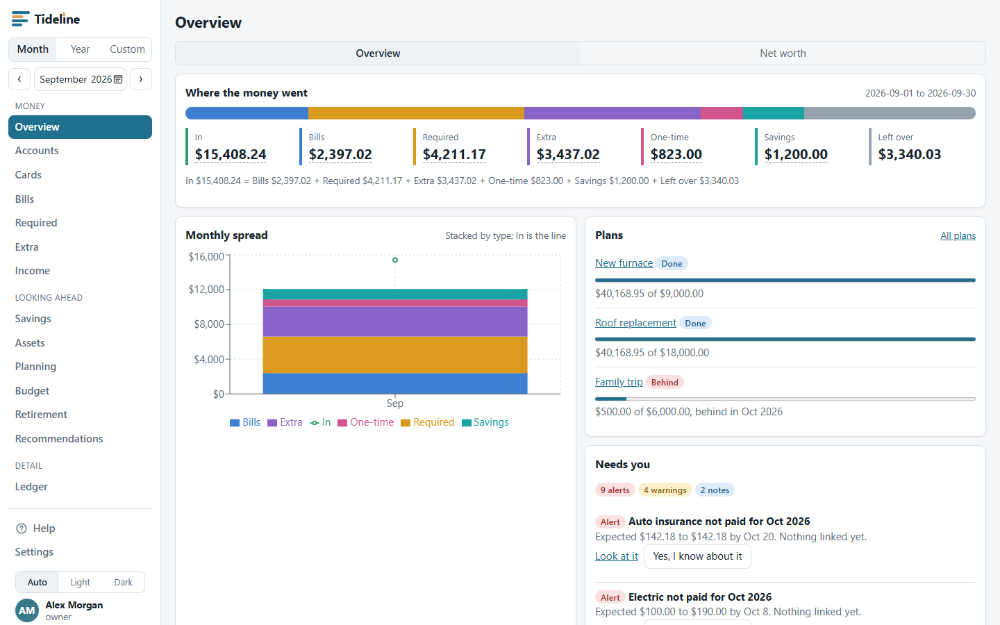

# Tideline
### A private household money ledger

> Know where the money went, and what needs you, without it becoming a hobby.

Tideline is a self-hosted ledger for a household. You give it your bank exports, it sorts every transaction, and it shows where the month's money went: what came in, what the bills were, what you had to spend, what you chose to spend, what you saved, and what was left. It keeps quiet until something needs a person, such as a bill that did not get paid or a card balance that was carried over. One Docker image, one data folder, nothing sent anywhere.

---

## A Note on How This Is Built

Tideline is built with **[Claude Code](https://claude.ai/code)**. The behaviour is written down first, in [`docs/`](docs/README.md), and that spec is the contract: code that disagrees with it is a bug. Work is broken into phases tracked as GitHub issues, and every change ships with tests (xUnit for the server, Vitest and Playwright for the web app, and a CI run on Linux). The issue history and the commit log show how each piece got here.

---

## What it does

Tideline is three things in one app:

- **A ledger you can trust.** Every bank line is kept exactly as the bank gave it and can never be edited or deleted. You change what a line *means* (its category, type, tags, splits), never the amount or the date. Money moving between your own accounts is a transfer, not spending, so nothing is counted twice.
- **A summary you can check.** Every month adds up the same way: money in equals bills, plus required, plus extra, plus one-time, plus savings, plus what is left over. Every number on every screen is a link to the exact lines behind it.
- **A watcher that stays quiet.** It looks for the few things that need a person and tells you only about those, in the app and, if you want, by webhook or email.

---

## Screenshot



More views: see [docs/screenshots/](docs/screenshots/README.md).

---

## Features

### Your ledger
- **Import bank files.** Upload a CSV export, or drop files in an inbox folder and they are picked up on their own. The account is found from the file name, lines already imported are skipped, so overlapping files are safe.
- **Bank rows never change.** Imported fields are written once, and database triggers refuse any attempt to change or delete them.
- **One meaning per line.** Each line is exactly one of Income, Bill, Required, Extra, One-time or Savings. Free-form tags never change the totals.
- **Transfers paired for you.** The two sides of a move between your own accounts are matched by amount and date window, and pairing can be done or undone by hand.
- **Rules that learn your habits.** Conditions on the description, amount range, check number or account set a category, type, payee and tags. Try a draft rule over a past period and see every line it would change before you save it. Make a rule straight from a line.
- **Split a line** across categories and types without changing its total. Edit many lines at once. Add a line by hand for cash. Tag lines for review.
- **The bank's balance is the check.** After every import the ledger is compared with the bank's running balance, to the cent. A file that does not add up is refused, with the reason.

### Where the money went
- **Overview.** The month at a glance: In, Bills, Required, Extra, One-time, Savings and Left over, the monthly spread chart, your plans, and what needs you.
- **Accounts by month**, **Credit cards** (was each one paid in full, and what was bought), a **Bills grid** (one row per recurring bill, one column per month, with paid, due, missing, unusual and projected clearly shown), **Required**, **Extra** (with subscriptions and price changes), and **Income** (expected against actual).
- **Everything drills down.** Click any number and see the lines behind it.

### Looking ahead
- **Budget** guidelines per category, checked against what you actually spent, with a heads-up when a category pops. One click proposes guidelines from your own history.
- **Plans.** Save toward a furnace or a trip with a target and a date. See whether you are on track and how much a month would finish it on time.
- **Savings** balances, monthly deposits and the interest they earn.
- **Net worth** with a month-end trend, what you own and what you owe, each figure dated and flagged when it is an old estimate.
- **Loans.** See the payoff month and the interest left, and try an extra amount each month to see the time and interest saved.
- **Assets.** For a house or a car: what it is worth, what is owed on it, the equity, and what you have put into it over its life, compared with how its value changed. Link a repair or a set of tires to an asset from the line.
- **Retirement.** What you will need, what you are on course for, the gap, the extra per month that closes it, and how long the money lasts. A projection to think with, with every assumption editable.

### Alerts, suggestions and notifications
- **Sixteen kinds of alert**, all quiet by default: a bill not paid or paid at an odd amount, a card not paid in full or charged interest, a ledger that disagrees with the bank, a failed import, an unpaired transfer, a payment that looks like a new loan or a new recurring charge, a budget that popped, short income, a plan that slipped, a large one-time item, lines to review, and a retirement gap that grew.
- **Needs you.** Acknowledge an alert with a note and it stops asking. It clears by itself when the cause is fixed.
- **Recommendations.** A plain suggestion for each kind of alert, such as what to check when a bill is late. Dismiss, edit, switch off or write your own.
- **Webhook and email.** Choose per kind whether to send now, hold for the monthly summary, or turn off. Quiet hours, digests, retries, and a monthly summary with the real numbers.

### Getting data in
- **CSV upload** from any browser, including a phone, and an **inbox folder** you can point at a shared folder.
- **SimpleFIN** for automatic sync every few hours, with a takeover day per account, a request limit, and a "try a month first" comparison against your files before you switch.
- **Manual entry** for anything the bank does not report.

### Security and privacy
- **Two steps every time.** A password and an authenticator app code, for every person. It cannot be turned off. Ten single-use recovery codes, shown once.
- **Your own account page.** Change your name and password, move to a new phone, make new recovery codes, and see and end the devices signed in as you.
- **Roles.** Owner, member and viewer. Deny by default, with a test that checks every route.
- **Every change is recorded.** An append-only audit log with before and after, that nobody can edit. Sign-ins, failures and lockouts are in it too.
- **Account numbers are never stored.** Only the last four digits, as a keyed hash plus a sealed copy, and the app only ever shows `••••1111`.
- **Secrets sealed.** Authenticator secrets, webhook addresses, mail passwords and the SimpleFIN address are encrypted at rest.
- **Sessions and guards.** Strict cookies, anti-forgery on every change, sign-in rate limits and lockout, and security headers.
- **Read-only API tokens** for dashboards and automations, shown once and stored only as a hash.
- **Backups you can check.** A consistent copy while the app runs, verified by opening it and adding it up, 30 days kept. Export everything as CSV at any time.

### Made to live at home
- **One container**, one data folder, runs as an unprivileged user on a read-only file system. SQLite, so there is no database server to run.
- **Runs on Linux and Windows.** The test suite runs on both.
- **Light and dark**, and it works on a phone.
- **Help built in.** Plain-words guides for each part of the app, from the menu.

For a fuller tour of each screen, see [docs/FEATURES.md](docs/FEATURES.md).

---

## Quick Start

You need Docker. From a clone of this repository:

```bash
docker compose -f deploy/compose.local.yaml up -d --build
```

The first build runs the whole test suite inside the build, so give it a few minutes. Then open **http://localhost:8080**. An empty Tideline asks you to create the first account (you become the owner), and then to set up an authenticator app and save your recovery codes.

Want something to look at before using your own data? This loads a made-up household with 5,000 lines:

```bash
docker exec tideline_app tideline demo /tmp/demo --lines 5000 --load
```

Start over with an empty app at any time:

```bash
docker compose -f deploy/compose.local.yaml down -v
```

The local compose file binds to this computer only. See [docs/11-deploy.md](docs/11-deploy.md) for backups, the inbox folder, and the production notes, and [docs/DEVELOPMENT.md](docs/DEVELOPMENT.md) to run it from source.

---

## Configuration

### Environment variables

Settings use the `Section__Name` form, which is how .NET reads them from the environment.

| Variable | Description | Default |
|---|---|---|
| `Tideline__PublicUrl` | The address people use. Used in setup links and notifications | `http://localhost:5173` (the compose file sets `http://localhost:8080`) |
| `Tideline__TrustedProxies` | Your reverse proxy's address or range, comma separated (`172.18.0.5`, `172.18.0.0/16`). Only these are believed about who the visitor is. Leave empty with no proxy | empty |
| `Tideline__Timezone` | IANA time zone for "today" and month boundaries | `America/New_York` |
| `Database__ConnectionString` | The SQLite file | `Data Source=tideline.db` (`/data/db/tideline.db` in the container) |
| `Tideline__DataProtectionKeys` | Where the encryption keys live. Back these up with the database | beside the database (`/data/keys` in the container) |
| `Tideline__BackupPath` | Where backups are written | `backups` beside the database (`/backups` in the container) |
| `Tideline__InboxPath` | A folder to watch for CSV exports. Empty turns the watcher off | off |
| `Tideline__InboxIntervalSeconds` | How often the inbox is looked at | `300` |
| `Tideline__SecureCookie` | Mark the sign-in cookie Secure. Keep on, including behind HTTPS | `true` |
| `Tideline__IdleHours` / `Tideline__AbsoluteDays` | Sign out after this long idle, or this long in total | `12` / `14` |
| `Tideline__AuthRequestsPerMinute` | Limit on sign-in attempts per address | `10` |
| `Tideline__MaxFailedLogins` / `Tideline__LockoutMinutes` | Wrong tries before a lock, and how long it lasts | `5` / `15` |
| `Notify__Enabled` | Run the nightly alert check, notifications and monthly summary | `true` |
| `SimpleFin__Enabled` | Run the automatic bank sync | `true` |
| `ASPNETCORE_URLS` | What the app listens on | `http://0.0.0.0:8080` in the container |

### In-app settings

Everything about your household is set in **Settings** inside the app, not in files: accounts and card terms, categories and tags, recurring bills, rules, imports, SimpleFIN, notification channels and what each alert does, people, sessions, API tokens, logs and backups. The app ships empty: no household data is built in.

---

## Stack

| Layer | Choice |
|---|---|
| Backend | ASP.NET Core on .NET 10, minimal APIs, Dapper, FluentMigrator |
| Database | SQLite, one file. MariaDB is planned, not built |
| Frontend | React 19 and TypeScript, built with Vite, served by the same container |
| Tests | xUnit and FluentAssertions, Vitest, Playwright, CodeQL |
| Deployment | One Docker image, built in three stages: web, server, runtime |

For the layout, data model and design decisions, see [docs/00-architecture.md](docs/00-architecture.md).

---

## Principles

- **Bank rows are never edited or deleted.** Imported fields are written once; database triggers refuse changes.
- **No double entry.** One row per bank line. Money between your own accounts is a *move*, not a type.
- **One type per line**, so the spread always adds up.
- **Money is integer cents.** No floating point anywhere near a balance.
- **Every number drills down** to the lines behind it.
- **MFA is mandatory**, and every change is recorded in an append-only audit log.
- **Internal only.** Self-hosted, no public exposure.

---

## Documentation

Everything lives in [`docs/`](docs/README.md).

| Doc | What it covers |
|---|---|
| [FEATURES](docs/FEATURES.md) | A tour of every screen and what it does |
| [DEVELOPMENT](docs/DEVELOPMENT.md) | Run from source, the command line, tests |
| [00-architecture](docs/00-architecture.md) | The big picture: principles, diagram, data model, screens, phases |
| [01-overview](docs/01-overview.md) | Principles, vocabulary, the spread equation |
| [02-solution-layout](docs/02-solution-layout.md) | Stack, projects, packages, configuration, conventions |
| [03-database](docs/03-database.md) | Tables, portability rules, migrations |
| [04-domain-rules](docs/04-domain-rules.md) | Every calculation |
| [05-import](docs/05-import.md) | Truist CSV formats, external ids, balance check, inbox, SimpleFIN |
| [06-rules-engine](docs/06-rules-engine.md) | Conditions, actions, ordering, testing rules |
| [07-api](docs/07-api.md) | REST endpoints, drill-down contract, errors, paging |
| [08-screens](docs/08-screens.md) | Every screen: route, data, drill links, acceptance |
| [09-security](docs/09-security.md) | Users, MFA, sessions, roles, API tokens, encryption |
| [10-notifications-logging](docs/10-notifications-logging.md) | Alerts, monthly summary, audit and system logs |
| [11-deploy](docs/11-deploy.md) | The container, backups, production notes |
| [12-phases-and-tests](docs/12-phases-and-tests.md) | Build phases, test plan, open decisions |

---

## Status

Built and tested: the ledger, every screen, security, alerts, SimpleFIN, assets and recommendations. What is still to do is checking it against real households and devices, and the production deployment. Progress is tracked in the [GitHub issues](https://github.com/Digitalcheffe/tideline/issues).

The SimpleFIN client and the webhook and email senders have been tested against stand-ins, not the live services yet.

---

## No household data in this repository

The app ships empty. A household is set up inside the app and its data arrives through imports. Tests use made-up files written for the purpose, and every screenshot here is made-up data. Real bank exports, balances, account numbers, names, and secrets (passwords, tokens, API keys, encryption keys) never go in the repository.

---

## Built On

Tideline stands on these open-source projects:

| Project | Role |
|---|---|
| [.NET](https://dotnet.microsoft.com/) and [ASP.NET Core](https://learn.microsoft.com/aspnet/core) | The server |
| [Dapper](https://github.com/DapperLib/Dapper) | Data access |
| [FluentMigrator](https://github.com/fluentmigrator/fluentmigrator) | Database migrations |
| [SQLite](https://sqlite.org/) via [Microsoft.Data.Sqlite](https://learn.microsoft.com/dotnet/standard/data/sqlite/) | The database |
| [QRCoder](https://github.com/codebude/QRCoder) | The authenticator QR code |
| [React](https://react.dev/) and [Vite](https://vite.dev/) | The web app and its build |
| [TanStack Query](https://tanstack.com/query) | Loading and caching data in the web app |
| [React Router](https://reactrouter.com/) | Navigation |
| [Recharts](https://recharts.org/) | Charts |
| [xUnit](https://xunit.net/), [FluentAssertions](https://fluentassertions.com/), [Vitest](https://vitest.dev/), [Playwright](https://playwright.dev/) | Tests |

---

## License

MIT. See [LICENSE](LICENSE).

Tideline is a tool for organising your own household's records. It is not financial, tax or legal advice, and the retirement and planning screens are projections to think with.
