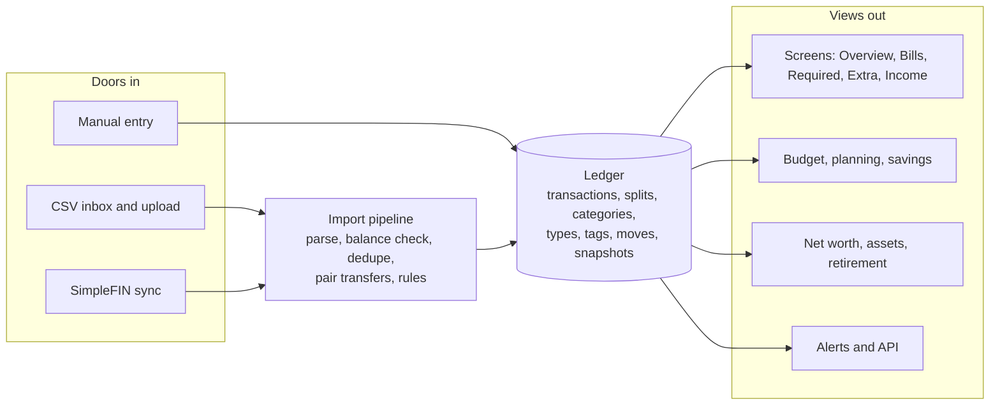

# Tideline architecture

Tideline is a self-hosted household ledger built so money stops running your life: one simple in/out ledger at the center, everything
else is a view of it, and it stays quiet unless something needs a person.

This is the one design document. It says how the pieces fit and why; the code and its tests are the detail.

## Principles

- **In and out, nothing more.** Single entry. A transaction is money into or out of an account. No debits, credits or expense accounts.
- **The bank is the truth.** Bank rows are never edited or deleted: amount, date and original description are written once at import, and
  database triggers refuse changes. Every account's balance is checked against the bank, which replaces double-entry bookkeeping. A person
  can change what a line *means* (category, type, tags, splits), or leave it out of the totals, never what the bank said.
- **One type per line.** Income, Bill, Required, Extra, One-time or Savings. That is what makes the month add up:
  **In = Bills + Required + Extra + One-time + Savings + left over.**
- **No double counting.** Money moving between your own accounts is a *move* (two lines sharing a `move_id`), not spending.
- **Everything drills down.** Every number on every screen opens the exact lines behind it, using one filter shape.
- **Money is integer cents.** No floating point near a balance. Rates are basis points.
- **MFA is mandatory** for every user, and every change a person makes is in an append-only audit log.
- **No household data in the repository.** The app ships empty; a household is set up in the app and fed by imports.

## How it fits together

One ledger sits at the center. Imports write to it through a single pipeline; every screen, report and alert only reads from it, so
change a category once and everything follows.

### The import pipeline

Nothing reaches the ledger without passing these, in order:

1. **Parse** the bank's file (Truist deposit and card CSV formats today; a new bank gets its own small parser).
2. **Check the file**: rebuild the running balance against the bank's daily balance. Any mismatch refuses the whole file, in words, before anything is written.
3. **Dedupe** by an external id per row, so a file imported twice adds nothing. A cutover date per account stops CSV and SimpleFIN covering the same days.
4. **Pair moves**: matching out and in lines on two of your accounts become one move.
5. **Rules**: the first matching rule sets category, type, payee, tags and links. No match means a catch-all category (Uncategorized) and a `review` tag; the type is Extra, except for money coming into a checking or savings account, which is Income until a person decides.
6. **Write and reconcile**: store the rows, record a bank balance snapshot, raise an alert if the ledger and the bank disagree.

A bad file is moved to `Failed` with a reason. An import that went in wrong (the wrong file or account) can be undone in one step, which
leaves its lines out of the totals; nothing is deleted.

### What a total counts

Reports do not read the transactions table directly. They read a shared set of "effective lines": each split line, plus whatever is left of
a transaction after its splits, with moves excluded and lines a person left out of the totals excluded. Savings moves are counted as Savings.
One definition means the Overview, Bills grid, drill-downs, budgets and alerts always agree.

## Data

Accounts, transactions and categories are the core; everything else hangs off them and never duplicates them. The full schema is
[`db/schema.sqlite.sql`](db/schema.sqlite.sql), and a test proves the migrations produce exactly that.

| Entity | What it is |
| --- | --- |
| Account | Checking, savings, credit card, loan, asset or retirement. Money accounts take their balance from the ledger; loans, assets and retirement from balance snapshots |
| Transaction | One bank line: account, date, amount (+ in, - out), original description, plus the person-editable payee, category, type, tags, notes, links |
| Split line | Part of a transaction with its own category and type; the remainder stays with the parent |
| Move | The two sides of money moving between your own accounts |
| Category, tag | A flat category list with a default type each; free tags that never change totals |
| Rule | An ordered match (description, amount, account) with actions; first match wins; never touches bank fields |
| Recurring | An expected repeating payment (amount range, due day); bill-type ones drive paid, due and missing on the Bills grid |
| Plan, budget | A saving goal with a date; per-category guidelines for the year (guidelines, not envelopes) |
| Balance snapshot | A balance on a day from the bank, a statement, an estimate or a calculation |
| Flag | Something that needs a person; acknowledged, not deleted |
| User, session, token, audit entry | Who may sign in, where they are signed in, API access, and what changed |

## Screens

A line's type decides which screen it lives on.

- **Overview**: the month's spread, plans on track, what needs you.
- **Accounts, Cards, Savings**: each account by month; whether each card was paid in full; savings balances and interest.
- **Bills, Required, Extra, Income**: a 12-month bill grid, category and payee totals, subscriptions and price changes, expected against actual income.
- **Ledger**: every line, filterable, with split, tag, link, pair, bulk edit, leave out, add by hand. It is also where every drill-down lands.
- **Budget, Planning**: guidelines and plans.
- **Net worth, Assets, Retirement**: what you own and owe, loan payoff, a house or car's equity and upkeep, and the retirement gap.
- **Recommendations**: prompts to look at something, shipped with the app. Each can be switched on or off.
- **Settings, Account, Help**: setup, security, and a how-to inside the app.

## Security

- **Sign-in**: password (PBKDF2 through ASP.NET Core's hasher) plus an authenticator app code (TOTP), with single-use recovery codes. No setting turns the second step
  off; the one exception is a fenced development switch that only runs in the Development environment and only on localhost.
- **Sessions**: a random token in a `__Host-` cookie, stored only as a hash; idle and absolute timeouts; CSRF protection on every change; a rate limit and an account lock on repeated wrong tries.
- **People**: roles (owner, member, viewer). The first account is created on first run; others join by a setup link that lasts 15 minutes and works once.
- **API tokens**: read-only unless given more, stored only as a hash.
- **Secrets**: authenticator secrets and channel passwords are sealed with keys kept beside the database and backed up with it. Bank account numbers are stored only as a keyed hash plus a sealed last four.
- **Audit**: every change by a person or token records who, what and the before and after, in a table nothing can edit or delete from.
- **Behind a reverse proxy**: list the proxy's address and only it is believed about the real visitor. The app is meant for a private network and is not built to face the internet.
- **Tuning**: a few limits (idle hours, wrong tries, lock time, attempts per minute, the inbox folder) start from the compose file and can be changed by the owner in the app.

## Notifications

A nightly check looks for the few things that need a person (a bill not paid, a card balance carried over, a plan slipping, an import that
failed, and so on). Each kind of alert is either sent now or held for a monthly summary, to a webhook or email channel, with a plain
suggestion attached. The app keeps an app-side record whether or not anything is sent.

**Suggestions** are shipped in a fixed list in code (`SuggestionCatalog`): a key, title, advice, small print and how often it can return. The logic of each is a small tested class run in the same daily pass as the alerts (and after each import); no stored SQL is run. A suggestion that raises its own card (tax, savings, cashflow, subscriptions) is a kind of flag like the alerts, so it clears itself when it stops being true, and Reviewed hides it for that period. The database keeps only each person's on/off switch per suggestion, so an update to the wording keeps everyone's switches. Whether one sends a message is one of the owner's notification choices.

## Running it

- **One container** serves the API and the web app. It listens on `TIDELINE_URL` (default `http://0.0.0.0:8080`).
- **Storage**: one SQLite file and its encryption keys under `/data`, backups under `/backups`, an optional CSV inbox folder. MariaDB is planned, not built.
- **Backups** are made from the app (a consistent copy, then checked); everything can also be exported to CSV.
- **Configuration** is environment variables in the compose file for what is decided at start-up, and the Settings screens for everything about the household. The variables are listed in the [README](../README.md#configuration).
- **Time zone**: "today" and month boundaries use one configured IANA time zone.

## Code layout

| Where | What |
| --- | --- |
| `src/Tideline.Core` | Pure rules with no database: rules engine, move pairing, recurring status, flags, retirement, passwords and codes |
| `src/Tideline.Data` | SQLite access (Dapper), migrations (FluentMigrator), reports and editors |
| `src/Tideline.Import` | Bank file parsers, the pipeline, the inbox and SimpleFIN |
| `src/Tideline.Notify` | The alert checks and the webhook and email senders |
| `src/Tideline.Api` | Minimal API endpoints, sign-in, the access policy, the web app host |
| `src/Tideline.Cli` | Admin commands run on the server (users, backups, demo data) |
| `web/` | React and TypeScript single-page app |
| `tests/`, `web/e2e/` | xUnit, Vitest and Playwright; CI builds and runs all of them |

Every change that adds a route has to say what it writes to the audit log, or a test fails.
