# Screenshots

Every screen here is made-up data from the demo household (`tideline demo`), not a real household.

## Getting started

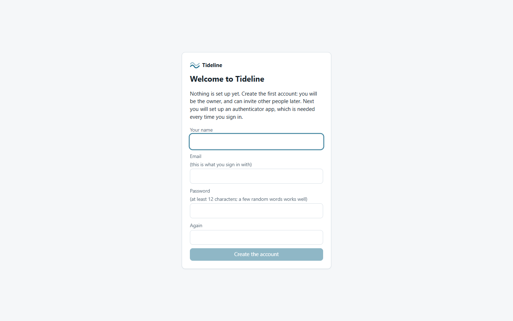
*A new, empty Tideline asks for the first account.*

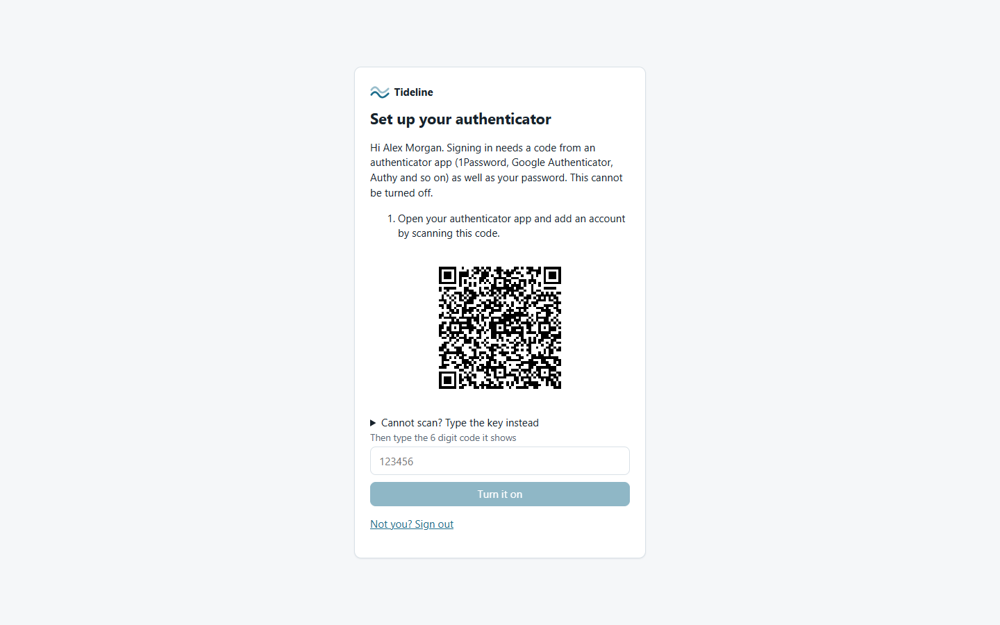
*Then the authenticator app. A password alone never opens anything.*

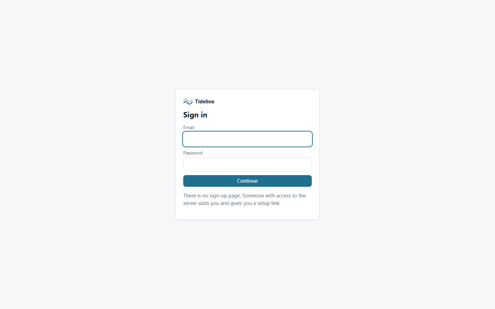
*Signing in: the password, then the code.*

## Where the money went

*The month at a glance: the spread, the plans, and what needs you.*

*One row per recurring bill, one column per month. The legend says what each status means.*

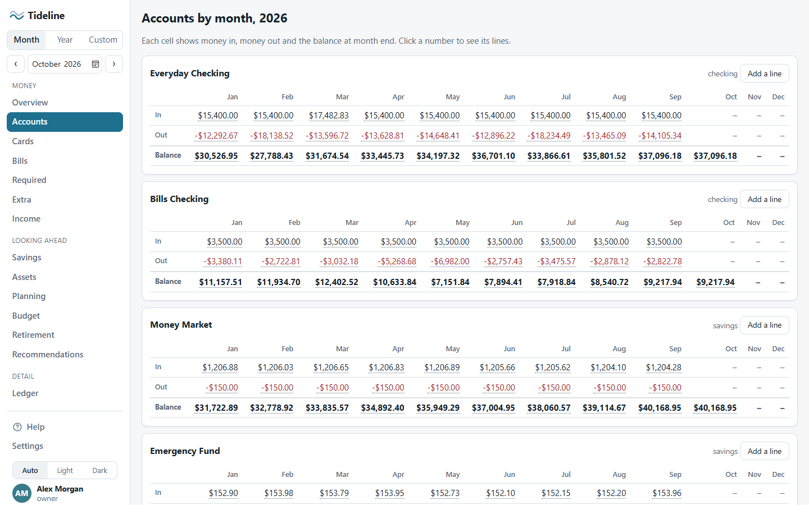
*Each account: money in, money out, and the balance at month end.*

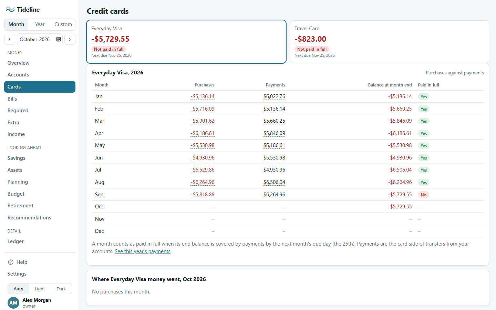
*Each card, whether it was paid in full, and what was bought.*

*Click any line to see what the bank said (it never changes) and what you decided it means.*

## Looking ahead

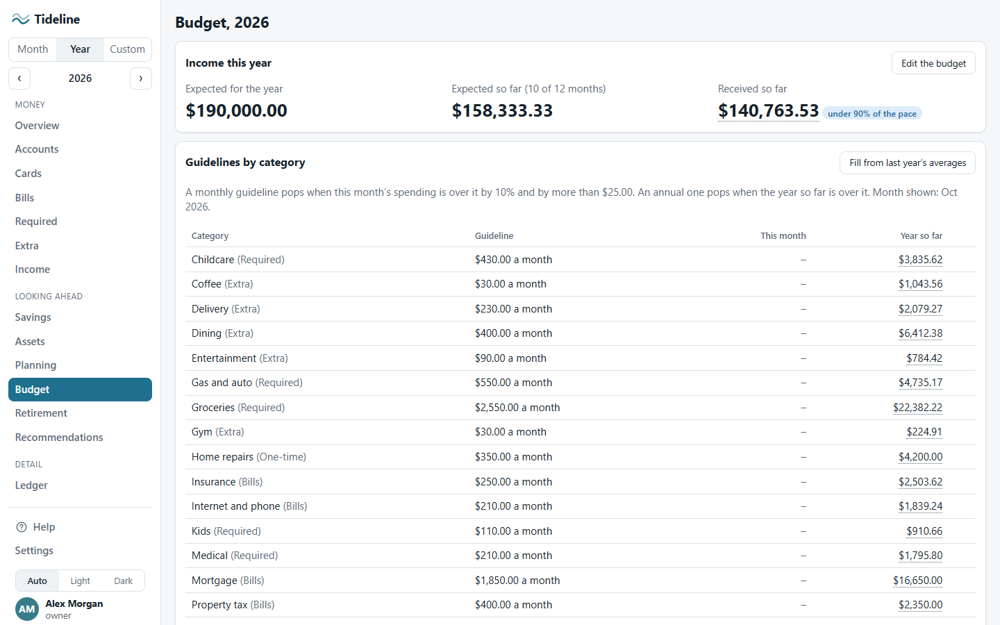
*A guideline per category against what was really spent.*

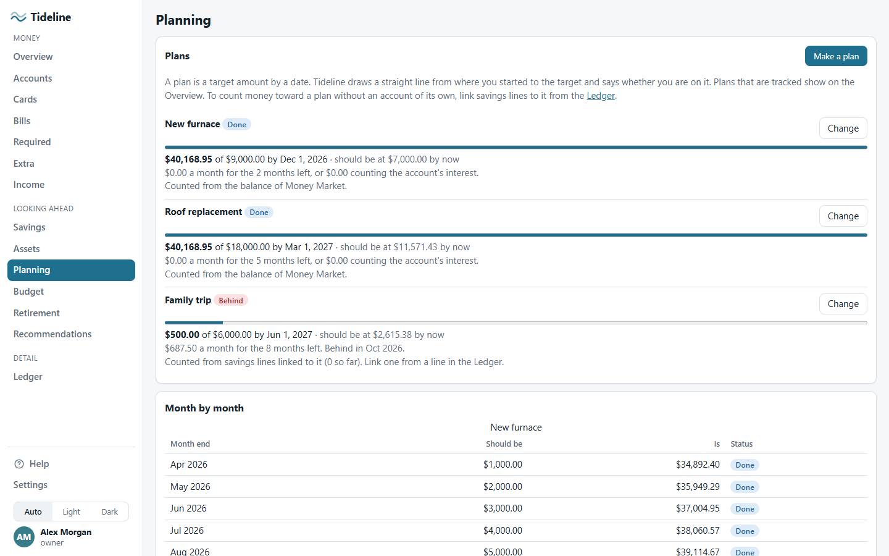
*Saving toward something, and whether you are on track.*

*What you will need, what you are on course for, and the gap.*

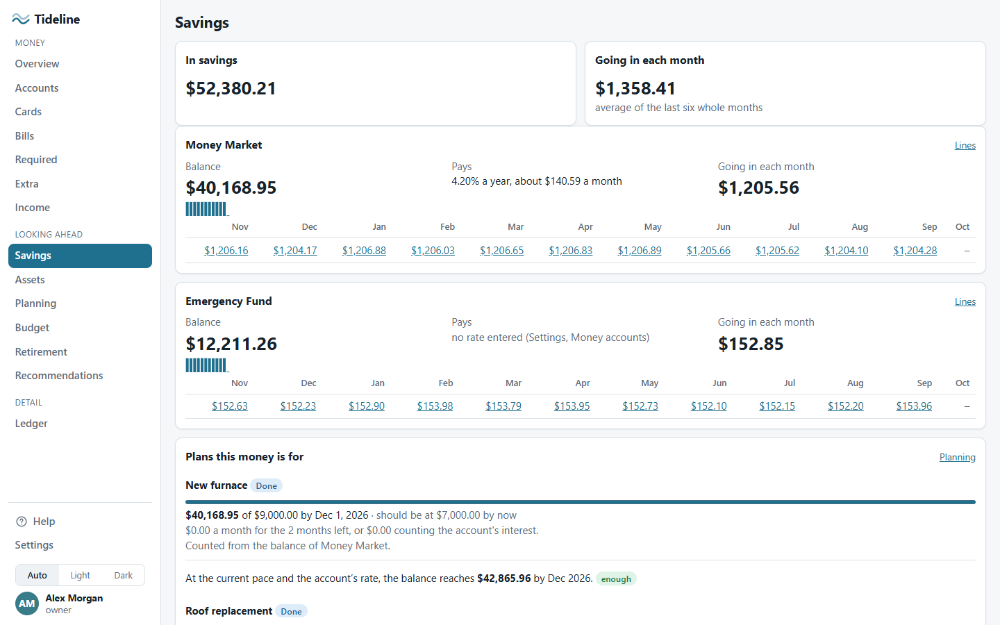
*Savings accounts, what goes in each month, and the interest.*

*A house or a car: what it is worth, what is owed, the equity, and what has been put into it.*

## Alerts and suggestions

*A plain suggestion for each thing that needs you. Edit them, switch them off, or add your own.*

## Setting up and running it

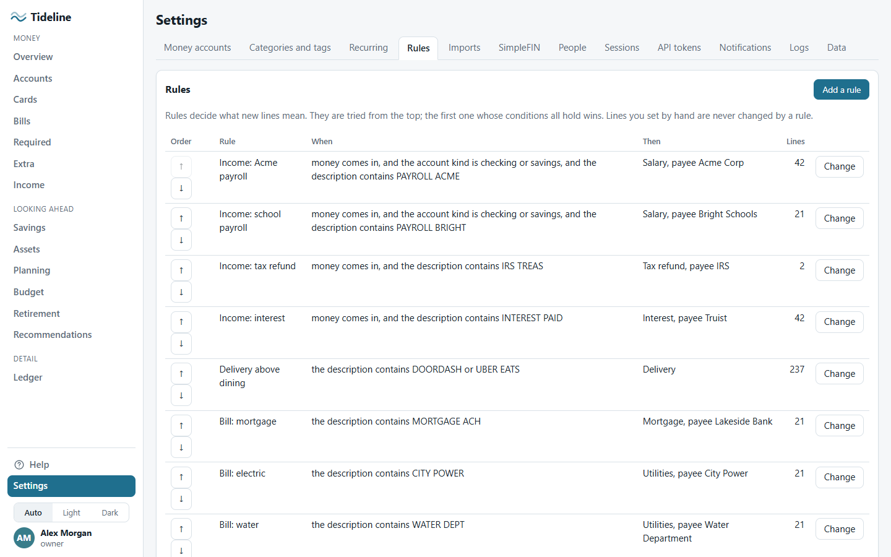
*Rules sort every new line. Try a draft over a past period before saving it.*

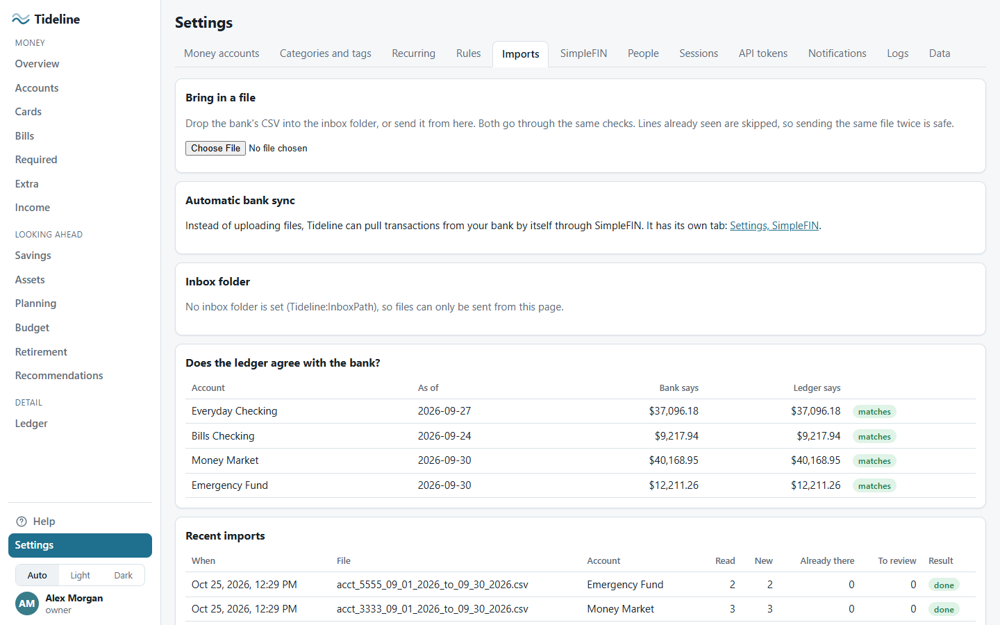
*Upload a file, see whether each account still agrees with the bank, and clear a failed import.*

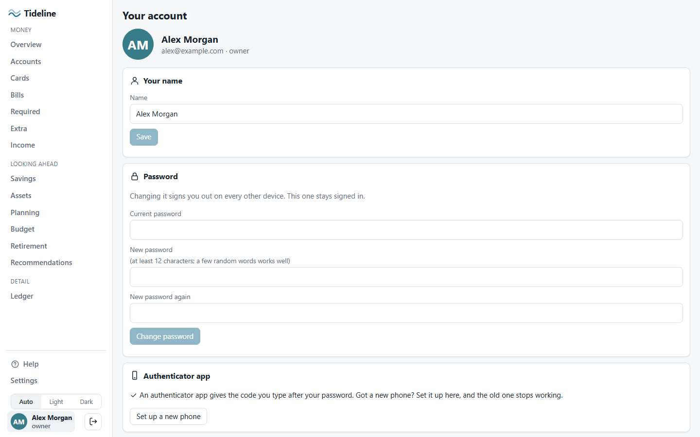
*Your name, password, authenticator app, recovery codes and the devices signed in as you.*

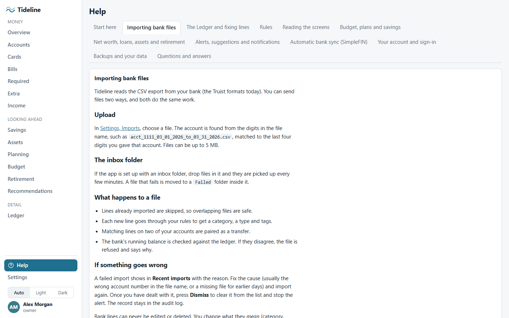
*How-to guides for each part of the app, built in.*

## Dark mode and phones

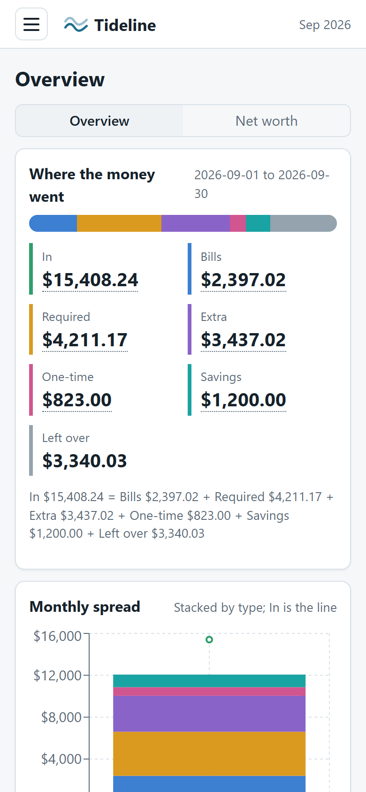
